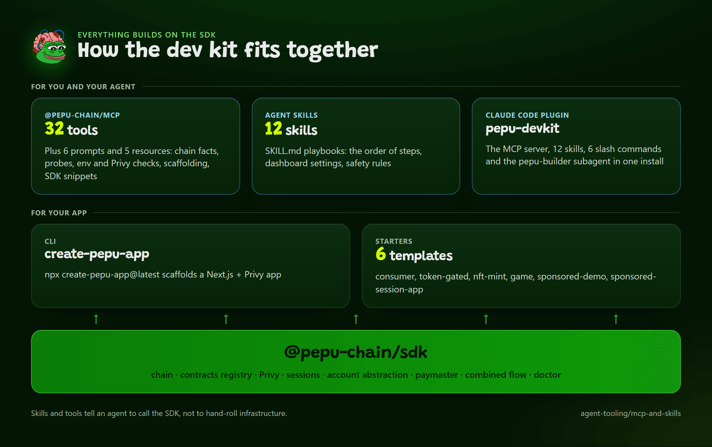

# Build with an AI Coding Agent in 3 Minutes

The fastest path for agent users: install the MCP server, the plugin and the skills, then scaffold and verify an app without leaving the agent. The agent does the code and config; you provide the Privy credentials. This page is the short path; detail is in the agent-tooling and MCP sections.



*Everything builds on the SDK.*

The MCP server (`@pepu-chain/mcp`: 33 tools, 6 prompts), 12 skills, 6 commands and the builder subagent (plugin 0.4.4) cover the whole dev kit. Gas sponsorship uses PEPU's hosted bundler and paymaster and needs a funded project of yours.

## Use it with an AI agent: the fast path (Claude Code)

Three steps, about three minutes of your time.

1. Install the plugin (once):

   ```text
   /plugin marketplace add pepu-org/pepu-devkit
   /plugin install pepu-devkit@pepu
   ```

2. In an empty folder, run the command with your idea:

   ```text
   /pepu-new-app a tap game where players pay no gas and approve once
   ```

3. Answer the agent when it asks for the few things only you have (below), then run what it tells you: `npm run dev`.

What `/pepu-new-app` does, in order:

| Step | What the agent does | Tool |
|---|---|---|
| 1 | Lists the templates and picks one by what you described, saying why in one line. For the idea above: `sponsored-session-app` | `pepu_list_templates` |
| 2 | Scaffolds the app into a new folder (the same as `npx create-pepu-app`), then installs dependencies | `pepu_scaffold_app` |
| 3 | Reads `.env.local`, fills what it can, and asks you for the rest by name without echoing secrets | `pepu_check_env` |
| 4 | Checks your Privy dashboard for the dev origin and tells you which rows to change | `pepu_check_privy_config` |
| 5 | For a sponsored template, checks the hosted bundler and paymaster live and says what is missing (your project's key) | `pepu_sponsorship_status` |
| 6 | Runs typecheck and build and ends with the three commands to run | |

What only you do:

1. Create the Privy app at [dashboard.privy.io](https://dashboard.privy.io) and give the agent the App ID and App Secret (or paste them into `.env.local` yourself).
2. Click the dashboard settings the agent lists: Allowed origins `http://localhost:3000`, Google on, embedded wallets on, and Smart Wallets only if it picked `sponsored-demo`. The exact clicks are in [Dashboard Settings](../privy/dashboard-settings.md).
3. For a sponsored template, get a paymaster project with its key. Ask: "Walk me through claiming and funding a paymaster project for my Privy app." The agent encodes the transactions with `pepu_prepare_project_tx`; you sign them with the owner wallet and run the SIWE and attestation script, which needs your wallet and your Privy secret. See [Register, Deposit and Claim a v2 Project](../infra/paymaster/v2-register-deposit-claim.md).
4. Run `npm run doctor`, then `npm run dev`, and click through the flow. When it looks right, the agent can re-run `/pepu-doctor` for a readiness report.

Other clients (Cursor, VS Code, Windsurf, Claude Desktop, Cline) get the MCP server only, no slash commands: use the first prompt below. The rest of this page is the manual route.

## Prerequisites

- Node.js 18.17 or newer and an MCP-capable agent client.
- A Privy account (you create the app and copy two values).

## 1. Install the MCP server

Every client takes the same stdio server:

```bash
npx -y @pepu-chain/mcp
```

Claude Code, Cursor, VS Code, Windsurf, Claude Desktop and Cline each have their own config file shape. The shared entry is:

```json
{ "mcpServers": { "pepu": { "command": "npx", "args": ["-y", "@pepu-chain/mcp"] } } }
```

Exact per-client steps: [Install per Client](../mcp/install.md). Scaffolded templates already ship a `.mcp.json`. No API key is needed. Optional env: `PEPU_BUNDLER_URL`, `PEPU_PAYMASTER_URL`, `PEPU_RPC_URL`.

## 2. Claude Code plugin

```text
/plugin marketplace add pepu-org/pepu-devkit
/plugin install pepu-devkit@pepu
```

It adds the MCP server, 12 skills, a builder subagent and six commands:

| Command | Does |
|---|---|
| `/pepu-new-app` | Scaffolds an app, choosing the template by pillar |
| `/pepu-add-login` | Google login and an embedded wallet |
| `/pepu-add-session` | Privy session keys |
| `/pepu-add-sponsorship` | Sponsored transactions, after a live availability check |
| `/pepu-add-sponsored-session` | The full combination |
| `/pepu-doctor` | Env, Privy dashboard and sponsorship readiness |

See [Claude Code Plugin](../agent-tooling/plugin.md) and [Skills Catalog](../agent-tooling/skills.md).

## What the agent does unattended, and what needs you

| Agent can | Needs a human |
|---|---|
| Scaffold the app (`pepu_scaffold_app`) | Create the Privy app at dashboard.privy.io |
| Write SDK code, routes and hooks | Copy the App ID and App Secret into `.env.local` (or paste them to the agent; the tools never echo secrets) |
| Generate the authorization key into `.env.local` without printing it | Register the public key and create the key quorum in the Privy dashboard |
| Check env keys, Privy config, sponsorship status | Set Allowed origins, enable Google, enable embedded wallets |
| Run `npm run doctor`, typecheck, build | Provide the paymaster project key for sponsored templates (`PEPU_PAYMASTER_URL`; the bundler defaults to the hosted one) |
| Explain a failed transaction or error | Click through the browser flow and approve Privy prompts |

## A first prompt

```text
Create a PEPU app that has Google login and a wallet. Use the pepu MCP tools and the
pepu-build-dapp skill. Scaffold it in ./my-app with the consumer-app template, tell me
exactly which Privy dashboard settings I must change, then run npm run doctor and
pepu_check_privy_config with origin http://localhost:3000 and report what is left.
```

For no-popup, no-gas, ask for the `sponsored-session-app` template and say you will supply a paymaster project token (the bundler URL defaults to the hosted one).

## What to expect

The agent lists the template choice with one line of reasoning, scaffolds, reports missing env keys by name, and finishes with a doctor report. Fields Privy does not expose come back `unknown`, not failed.

## Common failures

| Symptom | Cause | Fix |
|---|---|---|
| Tools not listed | MCP not registered or the client not restarted | [Install per Client](../mcp/install.md) |
| Doctor: `PRIVY_APP_SECRET` missing | You have not provided it | Add it to `.env.local`, restart dev |
| Agent claims sponsorship is live | Skipped the live check | Run `pepu_sponsorship_status` |

## Related

- [MCP Server Overview](../mcp/index.md)
- [MCP and Skills overview](../agent-tooling/mcp-and-skills.md)
- [Quickstart: Zero to a Sponsored Transaction in 10 Minutes](quickstart-app.md)
- [Smart Account Paths](../concepts/smart-account-paths.md)
- [AGENTS.md and CLAUDE.md in Templates](../agent-tooling/agents-md.md)
