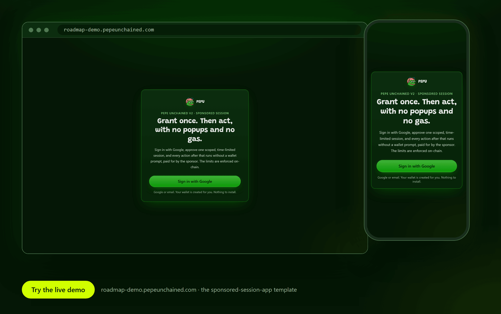

# What is Pepe Unchained V2

Pepe Unchained V2 is an Arbitrum Orbit (Nitro) chain, operated by Conduit, settling to Ethereum L1. It is a standard EVM chain — if you already know how to deploy and verify a Solidity contract on any Arbitrum Orbit chain, you already know how to do it here. Nothing about the execution environment is bespoke.

*Built with the dev kit: the live sponsored-session demo. [Try the live demo](https://roadmap-demo.pepeunchained.com).*

| | |
|---|---|
| **Mainnet chain ID** | `97741` |
| **Testnet chain ID** | `97740` (out of scope for development: no faucet, no indexed explorer, no deployed infrastructure) |
| **Stack** | Arbitrum Orbit / Nitro, ArbOS 51 |
| **Settles to** | Ethereum L1 (AnyTrust/Optimium DA — see [Network Properties](network-properties.md)) |
| **Native gas token** | PEPU, 18 decimals |
| **Operator** | Conduit |

Full copy-pasteable RPC URLs, explorers, and currency details are on the [Network Reference](network-reference.md) page. The deeper architectural picture — DA mode, precompiles, and an honest read of the chain's current L2BEAT rating — is on [Network Properties](network-properties.md).

Terms used on this page: [EntryPoint](../reference/glossary.md), [bundler](../reference/glossary.md), [paymaster](../reference/glossary.md), [Kernel](../reference/glossary.md), [session key](../reference/glossary.md), [project](../reference/glossary.md), [free tier](../reference/glossary.md). All are defined in the [Glossary](../reference/glossary.md).

## There is an old chain. This is not it.

If you've found a chain ID `3409`, an OP Stack reference, or a Celestia data-availability mention anywhere claiming to be "Pepe Unchained," that's the legacy V1 chain. It is dead. See [V1 vs V2](v1-vs-v2.md) before you configure anything.

## What you can build on today

The goal is a consumer app deployed quickly, without a founder spending weeks learning the chain. The dev kit covers three pillars; see [The Three Pillars](pillars.md).

| Pillar | What a builder can use today |
|---|---|
| Google login to an embedded wallet | Yes. [Embedded Wallets](../onboarding/privy-embedded-wallets.md), [Privy Setup](../onboarding/privy-setup.md). |
| Session keys, no popup per action | Privy mode: yes, the user pays gas. Kernel on-chain mode: yes, uses the hosted bundler and a funded project. [Session Keys](../onboarding/session-keys.md). |
| Sponsored transactions | Yes, through the **hosted** bundler and paymaster; you bring a funded project. [Sponsored Transactions](../onboarding/sponsored-transactions.md). |
| All three combined | Yes. [End to End](../onboarding/google-session-sponsored.md). |

A tiered sponsorship model (a daily free allowance for PEPU's own apps plus project deposits) is live on mainnet; see [Sponsorship Tiers](../onboarding/sponsorship-tiers.md).

## Endpoints at a glance

| | |
|---|---|
| RPC | `https://rpc-pepu-v2-mainnet-0.t.conduit.xyz` |
| Explorer | `https://pepuscan.com` |
| Bundler | `https://bundler.pepeunchained.com` (SDK default; `PEPU_BUNDLER_URL` overrides; local `http://localhost:4337`) |
| Paymaster | `https://paymaster.pepeunchained.com`; ERC-7677 URL `https://paymaster.pepeunchained.com/v2/paymaster/<token>` (`PEPU_PAYMASTER_URL` overrides; local `http://localhost:8788`) |

Full list: [Network Reference](network-reference.md) and [Endpoints](../reference/endpoints.md).

## What this section covers

This is the developer-facing documentation for building on Pepe Unchained V2: network parameters, contract deployment, verification, wallet and account onboarding (Privy setup, session signers, sponsored transactions, smart accounts), an SDK reference, copy-pasteable recipes, and agent tooling (an MCP server and coding-agent skills). It assumes you already know Solidity and standard EVM tooling (Hardhat, Foundry) — it does not re-teach those tools, only how they apply here.

If you want a running app (and, with a funded project, a sponsored transaction) in about ten minutes, go to [Quickstart: Zero to a Sponsored Transaction in 10 Minutes](quickstart-app.md). If you specifically want to deploy a Solidity contract, go to [Deploy & Verify a Contract](../contracts/deployment.md).

## Scope decisions

Two things are deliberately not part of the dev kit today:

- **No Telegram Mini App template.** Telegram restricts Mini Apps to the TON blockchain, so a PEPU Mini App template would not be accepted there. It is excluded, not postponed.
- **Global Wallet (a cross-app wallet) is deferred.** Each app provisions its own Privy embedded wallet. A shared wallet that follows a user between apps is not built.

