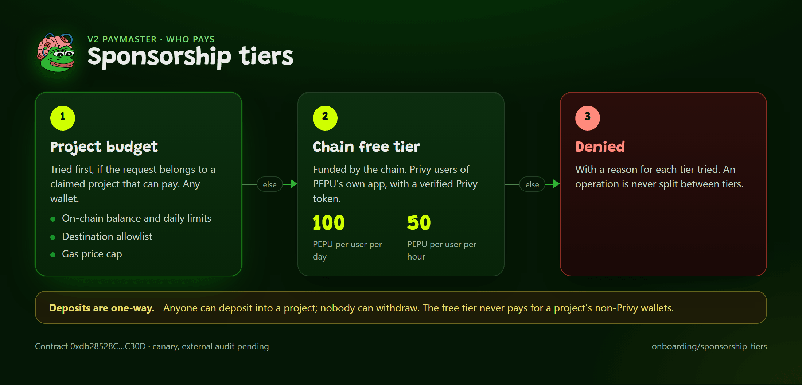

# Paymaster Overview

The PEPU paymaster lets an app pay gas on behalf of its users. It has two parts: an on-chain contract that holds the gas money and pays the EntryPoint, and an off-chain **policy service** that decides whether to approve a request and signs the approval. There are two versions. Version 2, the tiered model, is the live version. Version 1 is retired. Read this page to know which is which, what credentials each uses and where to go next.

*Who pays: project first, then the free tier, else denied.*

The v2 paymaster is deployed at `0xdb28528C9399C33c9A0297E8A62F39145acbC30D` and served through the hosted [bundler](../bundler/overview.md) and policy service. The hosted service base is `https://paymaster.pepeunchained.com`; the ERC-7677 URL always embeds a token (`https://paymaster.pepeunchained.com/v2/paymaster/<token>`), so there is no tokenless default. Deposits are one-way, so deposit only what your project needs. The v1 paymaster is retired. Local development default: `http://localhost:8788`.

## v1 versus v2

| | v1 | v2 |
|---|---|---|
| Contract | `PepuVerifyingPaymasterV7` at `0x2B6FED323bFA24f0475f4e1Dd3C7F6Cc1f3ae8B0` (retired) | `PepuSponsoredPaymasterV7` at `0xdb28528C9399C33c9A0297E8A62F39145acbC30D` (registry `paymasterV2`, alias `paymaster`) |
| Availability | Retired: the EntryPoint deposit has been withdrawn (0), so it cannot sponsor anything. Never deposit | Live on mainnet |
| Money | One shared EntryPoint deposit, no on-chain accounting | A ledger per sponsor inside one contract: a free pool plus one balance per project |
| Who sponsors | One operator (PEPU) for registered apps | The chain's free tier (Privy users) and any number of projects |
| Caps | Entirely off-chain in the policy service; the contract enforces none | Service caps plus on-chain destination allowlist, daily limit, per-wallet limit and gas-price cap per sponsor |
| Deposits | Operator tops up the EntryPoint deposit | Anyone deposits into any project; **one-way, nobody can withdraw** |
| Onboarding an app | An operator adds the app to `apps.json` by hand | Self-serve: claim the project on chain with a Privy-verified attestation, then configure it |
| Routes | `/health`, `/sponsor`, `/paymaster/:appToken`, `/admin/circuit-breaker/reset` (v1; not usable for sponsorship now) | The v1 routes plus `/v2/*`. The `/v2` routes are public (free-tier, config, SIWE, projects, verify); `/v2/admin` is not exposed |
| Auth | Privy access token and `X-Api-Key` (or the app key in the URL) | Server key `ppk_`, client token `ppt_` with allowed origins, SIWE session for owners, Privy token for the free tier |
| Pages | [REST API v1](rest-api-v1.md) | [REST API v2](rest-api-v2.md), [Register, Deposit and Claim](v2-register-deposit-claim.md), [Spec Summary](../../contracts/paymaster-v2-spec.md) |

v1 is retired. The two versions use different contracts, different SQLite files and different URL prefixes.

## What both versions share

- **ERC-7677 surface.** `pm_getPaymasterStubData` and `pm_getPaymasterData`, which is what Privy's smart-wallet client and viem's paymaster client call. See [ERC-7677 Methods](erc7677.md).
- **Kernel only.** The policy service decodes Kernel v3 `execute(bytes32,bytes)` calls (single or batch) to see which contracts an operation calls. Other account types and `executeUserOp` are denied.
- **EntryPoint v0.7**, chain `97741`, native PEPU as the only funding asset.
- **Operating model.** The service signs only after every check passes, the contract checks the signature and pays from its deposit. A compromised signer key is the one thing the v1 contract cannot stop; the float is kept small for that reason. See [Policy, Caps and the Circuit Breaker](policy-and-caps.md).

## Credentials in brief

| Credential | Format | Used for | Safe in a browser |
|---|---|---|---|
| Privy access token | JWT | Proving a Privy user (v1 `/sponsor`; v2 free tier) | Yes, it is the user's own |
| App key (v1) | raw key, hashed in `apps.json` | v1 `X-Api-Key` and the `/paymaster/<appToken>` URL segment | The URL is a secret; treat it as one |
| Server key | `ppk_...` | v2 backend sponsorship for any wallet | **No** |
| Client token | `ppt_...` | v2 ERC-7677 URL in a browser, only from allowed origins | Yes, by design (origin-bound) |
| SIWE session | opaque bearer, 1 hour | v2 project management | Held by the owner's browser |
| Privy app secret | Privy dashboard | One call, `POST /v2/projects/verify`; never stored | **No**, server or CLI only |

Details and the per-endpoint matrix are in [Credential Matrix](auth.md).

## Tiers

v2 splits sponsorship into a **free tier** (the chain pays, live allowance 100 PEPU per user per day and 50 PEPU per user per hour, enforced by the service; Privy users only, no chain-wide ceiling) and a **project tier** (a project funds its own budget and can sponsor any wallet). Free-tier targets are TapScore only for now (`0x261eA5971B93237a56990206A46Bc80318e4d078`); the manager can add more. The free pool was seeded with 300 PEPU. Beyond the free tier a dApp deposits into its own project. The full model, numbers and draw order are on [Sponsorship Tiers](../../onboarding/sponsorship-tiers.md) and in [Policy, Caps and the Circuit Breaker](policy-and-caps.md).

## How tokens behave

- **Client token (`ppt_`)** is publishable and works only from that project's allowed origins. With no origins set, or from another origin, it is refused with `project_origin_not_allowed`.
- **Server key (`ppk_`)** is secret. Backend callers put it in the ERC-7677 URL.
- **Free tier** needs a verified Privy access token from PEPU's own Privy app, sent as `context.privyAccessToken` in the ERC-7677 request (REST: `Authorization: Bearer`). A third-party app's own Privy token is ignored for billing, so third-party apps use a project. The Privy Smart Wallets dashboard URL is static and cannot attach a token, so the free tier is not reachable there.
- **Developer flow:** SIWE login, `POST /v2/projects/verify` with a Privy app id and secret (used for one request, never stored), `claimProject`, `setTargets`, `setDailyLimit`, `setSenderDailyLimit`, `depositFor`, register the project to get `ppt_` and `ppk_`, then set allowed origins for the client token. See [Register, Deposit and Claim](v2-register-deposit-claim.md).

## Hosting

| Piece | Location |
|---|---|
| v2 contract | `0xdb28528C9399C33c9A0297E8A62F39145acbC30D` |
| v2 policy service | `https://paymaster.pepeunchained.com` |
| ERC-7677 URL | `https://paymaster.pepeunchained.com/v2/paymaster/<token>` (always a token; `PEPU_PAYMASTER_URL` holds the complete URL) |

The SDK defaults to the hosted base for `createPaymasterApi`, probes, `checkSponsorship` and `doctor`; `getSponsorshipStatus()` and the `pepu_sponsorship_status` MCP tool probe the hosted bundler and paymaster base. `resolvePepuEndpoints()` returns `paymasterBaseUrl` and `paymasterUrl` (the complete ERC-7677 URL, or `null` when none is configured). Build a token URL with `hostedErc7677Url(token)` or pass `paymasterToken` to `createPepuPaymasterClient`. You can still run the policy service yourself; v2 is the path for outside teams.

## Common failures

| Symptom | Cause | Fix |
|---|---|---|
| `CONFIG_MISSING_ENV` for the paymaster URL | No complete ERC-7677 URL: the URL always embeds a token, so there is no tokenless default | Set `PEPU_PAYMASTER_URL` to `https://paymaster.pepeunchained.com/v2/paymaster/<token>` or pass `paymasterToken` |
| `project_origin_not_allowed` | A `ppt_` client token used with no allowed origins set, or from another origin | Set the project's allowed origins, or use the server key from a backend |
| `resolvePaymasterV2Address` throws | Only on a chain without a deployed v2 entry (testnet) | On mainnet it resolves to `0xdb28528C9399C33c9A0297E8A62F39145acbC30D`; never guess an address elsewhere |
| Sponsorship works locally but a teammate cannot reach it | You pointed at `http://localhost:8788` | Use `https://paymaster.pepeunchained.com` |
## Related

- [Credential Matrix](auth.md)
- [ERC-7677 Methods](erc7677.md)
- [REST API v1](rest-api-v1.md) and [REST API v2](rest-api-v2.md)
- [Policy, Caps and the Circuit Breaker](policy-and-caps.md)
- [Sponsored Transactions](../../onboarding/sponsored-transactions.md)
- [/paymaster SDK](../../sdk/paymaster.md)
- [Security Reviews](../../contracts/audits.md)
