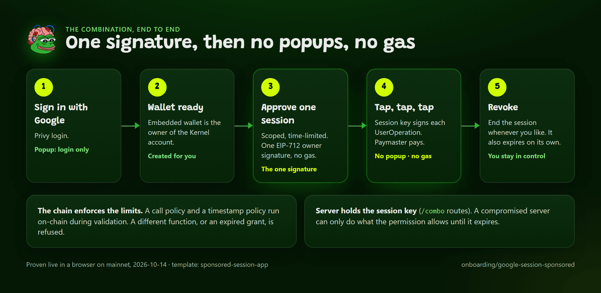

# Sponsored Session: No Popup, No Gas

The three onboarding pillars in one flow: sign in with Google, approve one scoped session, then act with no wallet popup and no gas from the user. This page summarizes the flow and the template. The full walkthrough, with every step, its SDK calls and its failure modes, is [Google Login, Session and Sponsorship End to End](google-session-sponsored.md).



*One signature, then no popups and no gas.*

Terms used on this page: [UserOperation](../reference/glossary.md), [Kernel](../reference/glossary.md), [session key](../reference/glossary.md), [paymaster](../reference/glossary.md), [project](../reference/glossary.md). All are defined in the [Glossary](../reference/glossary.md).

```bash
npx create-pepu-app@latest my-app --template sponsored-session-app
```

## Prerequisites

- A Privy app with Google on, `http://localhost:3000` in Allowed origins and embedded wallets on. No Smart Wallets setting. See [Dashboard Settings](../privy/dashboard-settings.md).
- The hosted bundler (`https://bundler.pepeunchained.com`, the SDK default) and a paymaster URL with your project's server key: `PEPU_PAYMASTER_URL=https://paymaster.pepeunchained.com/v2/paymaster/<project server key>` (secret, server only). You need a claimed and funded project; see [Sponsorship Tiers](sponsorship-tiers.md). To run your own services instead, the local defaults are `http://localhost:4337` and `http://localhost:8788`.

## Availability

- The hosted bundler and paymaster are available to app developers with a project: claim and fund one, then use its server key. The free tier is not available to third-party apps.
- All required contracts are present on chain 97741. Nothing needs to be deployed.
- The template stores sessions in server memory. Use a persistent `SessionStore` in production.
- `npm run prove-session` runs the flow from a script: one owner signature, then sponsored UserOperations signed by the session key alone, from an account holding 0 PEPU.

## How it differs from the other two pillar pages

- [Session Keys](session-keys.md), Privy mode: Privy session signers on a plain EOA. Scope enforced by Privy's backend, and the user pays gas.
- [Sponsored Transactions](sponsored-transactions.md): gas sponsored, but the owner signs every transaction.
- **This page:** a ZeroDev Kernel permission (call policy plus timestamp policy) installed by one owner signature. A session key held by your server signs UserOperations and a paymaster pays. The limits live on-chain in the user's smart account.

Because Privy's smart-wallet client cannot install a scoped session validator, the SDK builds the Kernel account itself (Path 1, ZeroDev-native). You do not enable Smart Wallets in the Privy dashboard. See [Smart Account Paths](../concepts/smart-account-paths.md) for how this differs from Privy Smart Wallets and when to pick each.

## What it is built from

| Job | SDK |
|---|---|
| Provider, wallet gate, ensure route | `PepuPrivyProvider`, `WalletGate` (`/privy/react`), `createEnsureWalletRoute` (`/privy/server`) |
| The five routes: prepare, activate, status, act, revoke | `createSponsoredSessionRoutes`, `createMemoryStore` (`/combo`) |
| The browser flow | `useSponsoredSession` (`/combo/react`) |
| Policies, owner approval, session account | `buildKernelSessionPolicies`, `approveKernelSession`, `loadKernelSessionAccount` (`/session/kernel`) |
| Gas numbers | `SESSION_GAS_RESERVATION_PEPU` (`/session/kernel`) |

Template layout: `lib/scope.ts` defines the one scope; `lib/session-routes.ts` is `createSponsoredSessionRoutes` plus the store; `app/api/session/{prepare,activate,status,act,revoke}` are one-line mounts; `components/session-flow.tsx` is the flow on `useSponsoredSession`; `scripts/prove-session.ts` runs the flow from a script. See [Sponsored Session App](../templates/sponsored-session-app.md).

## Trust model

- The owner key never leaves Privy and the browser. The server holds only the session key.
- A compromised server or leaked session key can do only what the permission allows until it expires.
- "Revoke" deletes the key on the server at once. It does not uninstall the permission on-chain: that is an owner-signed call to the user's own account, which a destination-allowlisted paymaster should not sponsor. The grant lapses at expiry, so keep sessions short (default 15 minutes, clamped to 24 hours).
- The default store is in memory. Production needs a real `SessionStore` with the session key encrypted at rest.
- Sponsorship is a separate trust relationship: the paymaster operator chooses what to pay for, within its caps. Size per-user caps for a session's first operation (deploy plus enable permission), which reserves about 20.5 PEPU worst case, and about 6.9 PEPU for later operations.

## Contracts used

Call policy v0.0.4 (`0x9a52283276A0ec8740DF50bF01B28A80D880eaf2`), timestamp policy (`0xB9f8f524bE6EcD8C945b1b87f9ae5C192FdCE20F`) and ECDSA signer module (`0x6A6F069E2a08c2468e7724Ab3250CdBFBA14D4FF`), on top of the Kernel v3.1 factory (`0xaac5D4240AF87249B3f71BC8E4A2cae074A3E419`) and ECDSA validator (`0x845ADb2C711129d4f3966735eD98a9F09fC4cE57`). Call policy v0.0.5 is not deployed on PEPU, so v0.0.4 is pinned. See [EntryPoints and Kernel](../contracts/entrypoints-and-kernel.md) and [Deployed Contracts](../contracts/deployed-contracts.md).

## Common failures

See the per-step tables in [Google Login, Session and Sponsorship End to End](google-session-sponsored.md). The two that bite first: `SESSION_APPROVAL_MISMATCH` (browser and server use different scopes; import one shared `scope`) and `trailing-hour spend ... would exceed cap` (per-user caps below the first-operation reservation).

## Related

- [Smart Account Paths: which one to use](../concepts/smart-account-paths.md)
- [The Two-Address Model](two-address-model.md)
- [Session Keys](session-keys.md)
- [Sponsored Transactions](sponsored-transactions.md)
- [Trust and Security Model](../concepts/trust-and-security.md)
