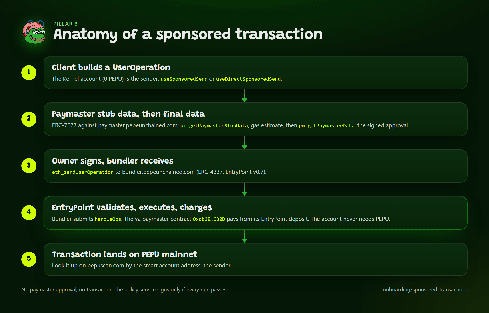

# Sponsored Transactions

Pillar 3 of the dev kit: a user with a wallet holding zero PEPU sends a transaction and a paymaster pays the gas. This page covers the hosted services, explains the architecture and trust model, gives the SDK code for both transports, lists the Privy settings, and maps the failures. It is the base for the sponsored session in [Google Login, Session and Sponsorship End to End](google-session-sponsored.md).



*From UserOperation to a transaction on pepuscan.*

The bundler (`https://bundler.pepeunchained.com`) and the paymaster service (`https://paymaster.pepeunchained.com`) are hosted by PEPU. The paymaster is the v2 `PepuSponsoredPaymasterV7` at `0xdb28528C9399C33c9A0297E8A62F39145acbC30D`. The v1 paymaster is retired. See [Sponsorship Tiers](sponsorship-tiers.md).

Terms used on this page: [UserOperation](../reference/glossary.md), [bundler](../reference/glossary.md), [paymaster](../reference/glossary.md), [EntryPoint](../reference/glossary.md), [Kernel](../reference/glossary.md), [project](../reference/glossary.md), [free tier](../reference/glossary.md). All are defined in the [Glossary](../reference/glossary.md).

The services are hosted, but sponsorship is not automatic for your app: you must bring a project (or, for PEPU's own apps, use the free tier). Only describe a transaction as "gasless" once sponsorship is configured and tested for your project. `usePepuSponsorship` and the `pepu_sponsorship_status` MCP tool answer the question live.

## Prerequisites

- Pillar 1 working ([Social Login and Embedded Wallets](privy-embedded-wallets.md)).
- A bundler for chain 97741 (ERC-4337, EntryPoint v0.7) and an ERC-7677 paymaster. PEPU hosts both (below). To run your own from `services/`, the local development defaults are `http://localhost:4337` and `http://localhost:8788`; `PEPU_BUNDLER_URL` and `PEPU_PAYMASTER_URL` override the hosted defaults.
- A way to pay, which is the part you must configure:
  - **Free tier (PEPU's own apps only).** Needs a verified Privy access token from PEPU's own Privy app in the ERC-7677 context (`context.privyAccessToken`; REST: `Authorization: Bearer`). A third-party app's own Privy token is ignored for billing and does not unlock the free tier. The Privy Smart Wallets dashboard URL is static and cannot attach a token, so the free tier is not reachable there. Per user: 100 PEPU a day and 50 PEPU an hour; free-tier targets are TapScore only for now.
  - **Your own project (any app).** SIWE login (`/v2/auth/nonce`, `/v2/auth/login`), verify your Privy app (`POST /v2/projects/verify`, app id and secret used for one request and never stored), claim (`claimProject`; immediate if empty, pending 48 hours if already funded), set targets and limits (`setTargets`, `setDailyLimit`, `setSenderDailyLimit`), deposit (`depositFor`, one-way), register the project, then set allowed origins for the client token. Full steps: [Sponsorship Tiers](sponsorship-tiers.md).
- Your target contract on the paymaster's destination allowlist and on your registered app's allowed destinations.

| Setting | Value |
|---|---|
| Chain ID | `97741` |
| Bundler URL | `https://bundler.pepeunchained.com` (SDK default; `PEPU_BUNDLER_URL` overrides) |
| Paymaster service | `https://paymaster.pepeunchained.com` (SDK default base; `PEPU_PAYMASTER_URL` overrides) |
| ERC-7677 URL | `https://paymaster.pepeunchained.com/v2/paymaster/<token>`; always embeds a token, so there is no tokenless default |
| v2 paymaster contract | `0xdb28528C9399C33c9A0297E8A62F39145acbC30D` (public, on-chain) |
| Retired v1 paymaster | `0x2B6FED323bFA24f0475f4e1Dd3C7F6Cc1f3ae8B0`: withdrawn, cannot sponsor, never deposit to it |
| EntryPoint v0.7 | `0x0000000071727De22E5E9d8BAf0edAc6f37da032` |

The SDK's single swap point for hosted URLs is `src/endpoints.ts` (`PEPU_HOSTED`): `{ bundlerUrl, paymasterBaseUrl, paymasterUrl: null }`. `resolvePepuEndpoints()` resolves, per value: explicit option, then the server env variable, then the `NEXT_PUBLIC_` variant, then the hosted default. It returns `bundlerUrl`, `paymasterBaseUrl` (the hosted base, or `PEPU_PAYMASTER_URL` with its `/v2/paymaster/<token>` tail stripped) and `paymasterUrl` (the complete ERC-7677 URL, or `null` when you have not supplied a token). Helpers: `hostedErc7677Url(token)` from `@pepu-chain/sdk/paymaster`, `hostedFreeTierUrl()` from `@pepu-chain/sdk`, `paymasterBaseOf(url)`, `buildErc7677Url({ baseUrl, token, version })`, and `isHostedSponsorshipLive()` (true).

## Architecture and trust model

A sponsored transaction is an ERC-4337 UserOperation. Five pieces cooperate:

1. **The user's smart account.** A ZeroDev Kernel v3.1 account owned by the embedded wallet. It is a different address from the wallet: see [The Two-Address Model](two-address-model.md).
2. **A bundler.** Accepts `eth_sendUserOperation` and gas estimation, and submits through the EntryPoint. PEPU's is a hosted Alto instance configured for Nitro's dual-fee gas (`--chain-type arbitrum`). The chain's standard RPC does not serve these methods.
3. **A paymaster contract.** Pays gas from its EntryPoint deposit after checking a signature from an authorized signer. The v2 contract holds per-project balances, daily limits and a destination allowlist on-chain; the retired v1 contract enforced no spending cap of its own.
4. **A policy service.** The off-chain ERC-7677 endpoint (`pm_getPaymasterStubData`, `pm_getPaymasterData`). It signs only if every rule passes: destination allowlist, per-user and per-app spend and count caps, and a global daily circuit breaker.
5. **The client.** Either Privy Smart Wallets or the SDK's `direct` transport.

What you trust: the paymaster operator decides what to pay for, within its caps. The destination allowlist is the real boundary: a sponsored call can only target approved contracts, so a drained budget can only pay for calls to approved contracts. The signer key is a hot wallet for the deposit, so the deposit is kept small and monitored. A paymaster URL is a credential: anyone holding it can request sponsorship as that app, within its caps. Details: [Infrastructure Map](../infra/overview.md), [Policy, Caps and the Circuit Breaker](../infra/paymaster/policy-and-caps.md), [Credential Matrix](../infra/paymaster/auth.md).

## The two transports

These are two smart-account paths: `privy-smart-wallets` is Path 2 (Privy builds the Kernel account) and `direct` is Path 1 (the SDK builds it, ZeroDev-native). [Smart Account Paths](../concepts/smart-account-paths.md) explains when to use each, what each can and cannot do, and how to migrate between them.

| | `privy-smart-wallets` (default) | `direct` |
|---|---|---|
| Who builds the smart account | Privy's smart-wallet client | The SDK, with ZeroDev (`toPepuKernelAccount`) |
| Where the URLs live | The Privy dashboard, Smart Wallets, chain 97741, provider Kernel | Your env, or options passed to the hook |
| Dashboard needs | Smart Wallets configured | Nothing beyond pillar 1 |
| Extra peers | None from ZeroDev | `@zerodev/sdk`, `@zerodev/ecdsa-validator` |
| Who signs | The owner, per transaction | The owner, per transaction (unless you use a session) |
| Credential exposure | The paymaster URL is stored in Privy's dashboard | The URL must reach the browser (`NEXT_PUBLIC_`), or you send from a server |
| Free-tier context | Not sent | The Privy access token is passed as paymaster context |
| Used by | `sponsored-demo` | `sponsored-session-app` (server side, with a session key) |

A smart-wallet page that spins forever on "Setting up your smart wallet..." means Smart Wallets is not configured for chain 97741 in the dashboard. That is not fixable in code.

## SDK code

### Browser: `useSponsoredSend`

```tsx
"use client";
import { useSponsoredSend, usePepuSmartAccount, usePepuSponsorship } from "@pepu-chain/sdk/aa/react";
import { WalletGate } from "@pepu-chain/sdk/privy/react";

function Tap() {
  const { smartAccount } = usePepuSmartAccount();      // the Kernel address, not the EOA
  const sponsorship = usePepuSponsorship();            // live probe of bundler and paymaster
  const { send, status, result, error } = useSponsoredSend({ transport: "privy-smart-wallets" });
  return (
    <button
      disabled={status === "signing" || status === "submitting"}
      onClick={() => send([{ to: tapScoreAddress, abi: tapScoreAbi, functionName: "tap" }])}
    >
      Tap from {smartAccount}
    </button>
  );
}
```

`send(calls)` takes `Call[]`, sends one UserOperation and resolves `SponsoredResult`: `userOpHash`, `transactionHash`, `success`, `paymaster`, `actualGasCostWei`, `explorerUrl`. Status is `idle`, `signing`, `submitting`, `confirmed` or `error`. One send at a time: a second call while one is in flight throws. Errors are typed: `describeUserOpFailure` turns AAxx codes and paymaster reasons into `PepuError`s with a `code` and a `hint`, with tokens and keys redacted. For `privy-smart-wallets`, wrap the app in Privy's `SmartWalletsProvider` nested inside the Privy provider (`composeProviders` from `/privy/react` builds the nesting).

For your own bundler and paymaster, use `useDirectSponsoredSend` from `@pepu-chain/sdk/aa/react-direct` (peers `@zerodev/sdk` and `@zerodev/ecdsa-validator`). Pass the URLs explicitly in browser code, because frameworks only inline literal `process.env.NEXT_PUBLIC_X` reads:

```tsx
import { useDirectSponsoredSend } from "@pepu-chain/sdk/aa/react-direct";

const { send } = useDirectSponsoredSend({
  bundlerUrl: process.env.NEXT_PUBLIC_PEPU_BUNDLER_URL,
  paymasterUrl: process.env.NEXT_PUBLIC_PEPU_PAYMASTER_URL,
});
```

Everything with `NEXT_PUBLIC_` is visible to every visitor. A paymaster URL carries a token: a project client token (`ppt_`) is publishable but only works from its allowed origins, whereas a server key (`ppk_`) must never reach a browser. Prefer the Privy transport for browser sends, or send from a server with a session key (the combination).

### Server or script: `sendSponsored`

```ts
import { createPublicClient, http } from "viem";
import { pepuMainnet } from "@pepu-chain/sdk";
import { createPepuSponsoredClient, sendSponsored, toPepuKernelAccount } from "@pepu-chain/sdk/aa/kernel";

const publicClient = createPublicClient({ chain: pepuMainnet, transport: http() });
const account = await toPepuKernelAccount({ publicClient, owner }); // owner: a viem account or wallet client
const client = createPepuSponsoredClient({ account, paymasterToken: process.env.PEPU_PAYMASTER_TOKEN }); // server key (secret)
const r = await sendSponsored({ client, calls: [{ to, abi, functionName: "tap" }] });
console.log(r.paymaster, r.actualGasCostWei, r.explorerUrl);
```

`createPepuSponsoredClient` sends through the hosted bundler (or `PEPU_BUNDLER_URL`) with gas paid by your paymaster, and takes fees from the chain with 20% headroom. Pass a `paymasterToken` (your project's server key on a backend) and it builds `https://paymaster.pepeunchained.com/v2/paymaster/<token>` against the hosted base; `createPepuPaymasterClient` accepts the same option, and `requirePaymasterUrl(explicit?, token?)` does the resolution. With no token and no `PEPU_PAYMASTER_URL` it throws a typed `CONFIG_MISSING_ENV` error rather than guessing one.

### Check availability

```ts
import { checkSponsorship } from "@pepu-chain/sdk";
import { getPaymasterDeposit } from "@pepu-chain/sdk/aa";

const s = await checkSponsorship({ publicClient });   // never throws for an unreachable service
if (!s.available) console.log(s.reason, s.fixes);
```

To confirm a sponsorship happened, check the paymaster's EntryPoint deposit rather than the transaction hash. Compare `getPaymasterDeposit` before and after: the deposit drops while the smart account stays at 0 PEPU. The result's `paymaster` field also names who paid.

`getSponsorshipStatus` is deprecated and always says unavailable; use `checkSponsorship`.

## Privy dashboard

Only the `privy-smart-wallets` transport needs Smart Wallets. For chain 97741, choose provider **Kernel**, enter the bundler URL `https://bundler.pepeunchained.com` and the paymaster URL `https://paymaster.pepeunchained.com/v2/paymaster/<project token>`. Use your project's client token (`ppt_`) with your app's origins allowed, because Privy calls from the browser; never use the server key (`ppk_`) there. The dashboard URL is static and cannot attach a Privy token, so the free tier is not reachable from it. Field detail: [Dashboard Settings](../privy/dashboard-settings.md). Allowed origins and embedded wallets apply to both transports.

## Tools and template

| Need | Tool |
|---|---|
| "Can I send a sponsored transaction right now?" | `pepu_sponsorship_status` |
| Bundler or paymaster health | `pepu_bundler_health`, `pepu_paymaster_health` |
| Canonical code | `pepu_sdk_snippet` with `sponsored-send`, `sponsored-send-server`, `check-sponsorship` |
| Explain a failure | `pepu_explain_error`, `pepu_explain_tx` |
| Slash command and skill | `/pepu-add-sponsorship`, skill `pepu-sponsored-transactions` |

Template: `sponsored-demo`: sign in, get a Kernel account at 0 PEPU, click one button, watch the paymaster deposit drop. See [Sponsored Demo](../templates/sponsored-demo.md).

## Gas reservation

A first operation that deploys the account reserves about 12 PEPU at PEPU's gas price, and a follow-up about 3 PEPU; both move with the gas price. A session's first operation reserves about 20.5 PEPU. Size caps above these figures.

## Common failures

| `code` or symptom | Cause | Fix |
|---|---|---|
| `PAYMASTER_DESTINATION_NOT_ALLOWED` | The call targets a contract not on the allowlist | Add the contract to the global allowlist and your app's allowed destinations |
| `PAYMASTER_ORIGIN_NOT_ALLOWED` | The page origin is not allowed | Allow the exact origin, port included |
| `PAYMASTER_DENIED`, `AA32` to `AA34` | Credential or sender rejected, or the policy signer does not match the contract | Check the app key in the URL and that the account belongs to the signed-in user |
| `PAYMASTER_NO_BALANCE`, `AA31` | The project's balance (or the paymaster's EntryPoint deposit) cannot cover the operation | Deposit PEPU into the project (`depositFor`); deposits are one-way |
| `project_origin_not_allowed` | A client token (`ppt_`) was used with no allowed origins, or from another origin | Set the project's allowed origins, or use the server key (`ppk_`) from a backend |
| `PAYMASTER_CAP` | A per-op, per-user, per-app or global cap was hit | Wait for the window or raise the limits |
| `BUNDLER_AA_FAILED` (`AA25`) | Invalid nonce: another operation from this account is pending | Wait for it, then retry |
| `BUNDLER_UNREACHABLE` | The bundler URL is wrong or unreachable | Check `PEPU_BUNDLER_URL` (default `https://bundler.pepeunchained.com`); run `pepu_bundler_health` |
| `trailing-hour spend ... would exceed cap` after the first action | Per-user caps are below the worst-case reservation | Size caps above the first-operation reservation |
| Browser `Failed to fetch` to the bundler | The bundler has CORS off while a browser calls it | Enable CORS and put the bundler behind a filtering proxy; see [Operating the Bundler](../infra/bundler/operating.md) |

Full catalog: [Error Reference](../reference/errors.md). Hosting, Alto settings, the ERC-7677 request shapes and the policy service are in [Infrastructure Map](../infra/overview.md), [ERC-7677 Methods](../infra/paymaster/erc7677.md) and [Bundler Overview](../infra/bundler/overview.md).

## Related

- [Smart Account Paths: which one to use](../concepts/smart-account-paths.md)
- [The Two-Address Model](two-address-model.md)
- [Smart Accounts](smart-accounts.md)
- [Sponsorship Tiers](sponsorship-tiers.md)
- [Sponsored Session](sponsored-session.md)
- [/aa](../sdk/aa.md), [/paymaster](../sdk/paymaster.md)
- [Recipes: Send a Sponsored Transaction](../recipes/sponsored-send.md)
