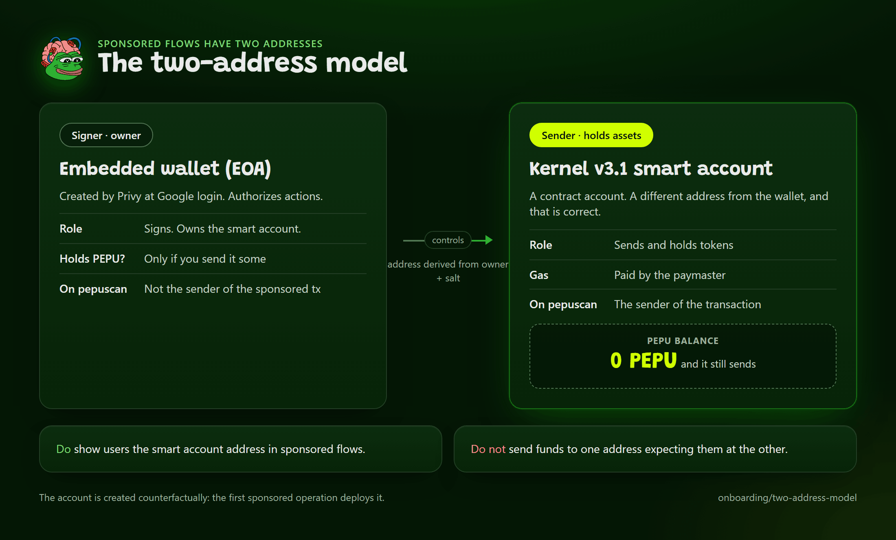

# The Two-Address Model

With gas sponsorship, one user has **two addresses**. This is the most common source of confusion when people first run the `sponsored-demo` template, so it is worth understanding before you build anything on smart accounts.

*The signer and the sender are different addresses.*

| | Embedded wallet (EOA) | Kernel smart account |
|---|---|---|
| What it is | A plain key-controlled account that Privy creates at login | A separate contract account, controlled by the EOA |
| Role | The **signer** (owner). It authorizes actions. | The **sender**. It transacts and holds assets. |
| Address | Its own | A different one, derived from the owner and a salt |
| Holds PEPU? | Only if you send it some | Can stay at zero: a paymaster can pay the gas |
| On pepuscan | Not the sender of the sponsored transaction | The sender of the transaction |

They are different addresses. The smart account's address will not match the embedded wallet's, and that is correct.

## What this means in practice

- **Show the smart account address** to users in any sponsored flow. That is the address that transacts, owns the tokens and receives transfers. The `sponsored-demo` template displays the Kernel address, not the EOA.
- **Never tell a user to send funds to one expecting them at the other.** PEPU sent to the EOA does not appear in the smart account, and the reverse. A sponsored smart account can legitimately hold zero PEPU; the demo shows exactly that, then proves sponsorship by watching the paymaster's own EntryPoint deposit drop.
- **Look the transaction up by the smart account address** on [pepuscan.com](https://pepuscan.com). The transaction is submitted by a bundler through the EntryPoint; the smart account is the sender, the account that acted.
- **Without sponsorship, there is only one address.** Plain embedded-wallet apps (the `consumer-app`, `token-gated-app`, `nft-mint` and `game-app` templates) use the EOA directly. Session signers also act on the plain EOA. The two-address model only applies when you use a smart account, which today means the sponsorship path.
- **The smart account is created counterfactually.** Its address can be computed before it is deployed, and the first sponsored transaction deploys it as part of the same operation.

## Where each address comes from

The embedded wallet is created by Privy at login (or server-side by the template's `POST /api/wallet/ensure` fallback). The Kernel account is built on top of that wallet in one of two ways (the two [smart account paths](../concepts/smart-account-paths.md)). With Privy Smart Wallets enabled for chain 97741 (provider Kernel), Privy's client produces the Kernel address as `account.address`. Otherwise the SDK builds it itself (`toPepuKernelAccount`, or `getKernelAddress` for a read before deployment), which is what `useDirectSponsoredSend` (`/aa/react-direct`) and the Kernel session flow (`useSponsoredSession`, `smartAccount`) do. In both, the address depends only on the owner, not on any session. `usePepuSmartAccount` (Privy Smart Wallets) and `useDirectSmartAccount` (`/aa/react-direct`) return `{ owner, smartAccount }`.

The factory, implementation and validator involved are on [Deployed Contracts](../contracts/deployed-contracts.md#erc-4337--smart-accounts-mainnet-only). If you need to compute a Kernel address for an owner yourself, `getKernelAccountAddress` in [`@pepu-chain/sdk`](../sdk/aa.md) and the `pepu_smart_account_info` tool in the [MCP server](../agent-tooling/mcp-and-skills.md) both read it from the factory's own on-chain `getAddress`.

If a user has both a Privy smart wallet and an SDK-built Kernel account, they have two smart accounts and three addresses in total; see [Mixing paths](../concepts/smart-account-paths.md#mixing-paths).

## Related

- [Smart Account Paths: plain wallet, ZeroDev-native or Privy Smart Wallets](../concepts/smart-account-paths.md)
- [Sponsored Transactions](sponsored-transactions.md)
- [Smart Accounts](smart-accounts.md)
- [Privy Setup](privy-setup.md)

