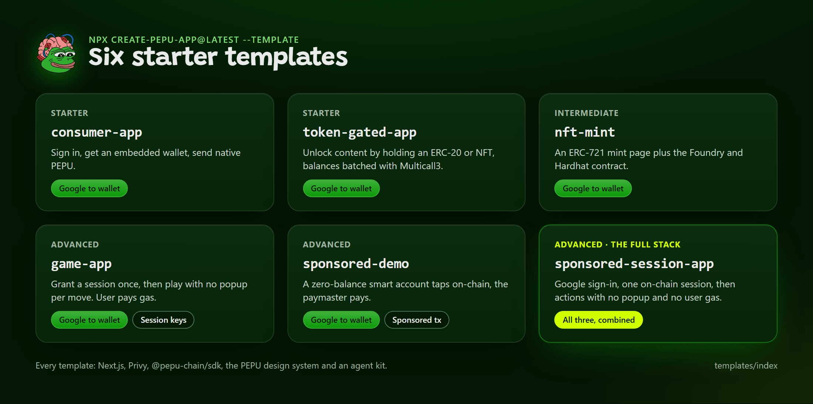

# Template Gallery

Six starter templates, each a complete Next.js app on Pepe Unchained V2 mainnet (chain `97741`) built on `@pepu-chain/sdk`. This page shows which pillars each one demonstrates, what each needs, and how to pick. It is derived from `packages/create-pepu-app/src/templates.json` and the SDK's `TEMPLATE_REQUIREMENTS`.



*Six templates, from a first login to the full stack.*

Each template README lists its setup. The sponsorship templates use the hosted bundler and paymaster but need a funded project of yours (claim, deposit, token).

## Prerequisites

- Node.js 18 or newer.
- A Privy app (App ID and App Secret) from [dashboard.privy.io](https://dashboard.privy.io). Every template needs one. See [Privy Setup Walkthrough](../onboarding/privy-setup.md).
- A little PEPU in the wallet for templates where the user pays gas.

## Gallery

| Template | What it shows | Difficulty | Pillars |
|---|---|---|---|
| [`consumer-app`](consumer-app.md) | Sign in, get an embedded wallet, send native PEPU | starter | Google to wallet |
| [`token-gated-app`](token-gated-app.md) | Unlock content by holding an ERC-20 or NFT, balances batched through Multicall3 | starter | Google to wallet |
| [`nft-mint`](nft-mint.md) | An ERC-721 mint page plus the Foundry and Hardhat contract | intermediate | Google to wallet |
| [`game-app`](game-app.md) | Grant a session once, then play with no wallet popup per move | advanced | Google to wallet, session keys |
| [`sponsored-demo`](sponsored-demo.md) | A zero-balance smart account taps on-chain, the paymaster pays | advanced | Google to wallet, sponsored transactions |
| [`sponsored-session-app`](sponsored-session-app.md) | Google or email sign-in, one on-chain session, then actions with no popup and no user gas | advanced | All three, combined |

## Pillar matrix

The three core pillars and their combination. "Login" means Privy login with a server-provisioned embedded wallet; Google is one of the login methods and is required by `sponsored-session-app`.

| Template | Google to wallet | Session keys | Sponsored transactions | Combination |
|---|---|---|---|---|
| `consumer-app` | Yes | No | No | No |
| `token-gated-app` | Yes | No | No | No |
| `nft-mint` | Yes | No | No | No |
| `game-app` | Yes | Yes, Privy session signer (off-chain scope, user pays gas) | No | No |
| `sponsored-demo` | Yes | No | Yes, Privy Smart Wallets transport | No |
| `sponsored-session-app` | Yes | Yes, on-chain Kernel session key | Yes, direct bundler and paymaster | Yes |

See [The Three Pillars and How They Combine](../get-started/pillars.md).

## Env needs at a glance

| Template | Required | Optional | Extra setup |
|---|---|---|---|
| `consumer-app` | `NEXT_PUBLIC_PRIVY_APP_ID`, `PRIVY_APP_SECRET` | none | none |
| `token-gated-app` | `NEXT_PUBLIC_PRIVY_APP_ID`, `PRIVY_APP_SECRET`, and at least one of `NEXT_PUBLIC_GATE_ERC20_ADDRESS` or `NEXT_PUBLIC_GATE_ERC721_ADDRESS` | the two gate addresses | none |
| `nft-mint` | `NEXT_PUBLIC_PRIVY_APP_ID`, `PRIVY_APP_SECRET`, `NEXT_PUBLIC_NFT_CONTRACT_ADDRESS` | none | Deploy the contract in `contracts/` first |
| `game-app` | `NEXT_PUBLIC_PRIVY_APP_ID`, `PRIVY_APP_SECRET`, `NEXT_PUBLIC_PRIVY_KEY_QUORUM_ID`, `PRIVY_AUTHORIZATION_KEY`, `NEXT_PUBLIC_GAME_CONTRACT_ADDRESS` | `SESSION_DURATION_MINUTES`, `PEPU_RPC_URL` | Generate and register the authorization key, deploy `TapScore` |
| `sponsored-demo` | `NEXT_PUBLIC_PRIVY_APP_ID`, `PRIVY_APP_SECRET` | `NEXT_PUBLIC_PAYMASTER_CONTRACT_ADDRESS` | Enable Smart Wallets in the Privy dashboard with `https://bundler.pepeunchained.com` and `https://paymaster.pepeunchained.com/v2/paymaster/<project token>` |
| `sponsored-session-app` | `NEXT_PUBLIC_PRIVY_APP_ID`, `PRIVY_APP_SECRET`, `PEPU_PAYMASTER_URL` (hosted URL with your project server key) | `PEPU_BUNDLER_URL` (defaults to the hosted bundler), `SESSION_DURATION_MINUTES`, `PEPU_RPC_URL` | A claimed and funded paymaster project of your own |

## Privy dashboard settings at a glance

| Setting | consumer | token-gated | nft-mint | game | sponsored-demo | sponsored-session |
|---|---|---|---|---|---|---|
| A login method enabled | Required | Required | Required | Required | Required | Required |
| Google login enabled | | | | | | Required |
| Allowed origin with exact port (`http://localhost:3000`) | Required | Required | Required | Required | Required | Required |
| Embedded wallets enabled | Required | Required | Required | Required | Required | Required |
| Authorization key and key quorum | | | | Required | | |
| Smart Wallets (chain `97741`, Kernel, bundler and paymaster URLs) | | | | | Required | Not needed: it builds its own Kernel account |

Field-by-field instructions: [Dashboard Settings, Field by Field](../privy/dashboard-settings.md).

## Choosing a template

| If you want | Use |
|---|---|
| Your first app: login, wallet, send | `consumer-app` |
| Holder-only content, communities, perks | `token-gated-app` |
| A mint page for your own collection | `nft-mint` |
| Many fast actions with no popup, and your users pay gas | `game-app` |
| To see sponsorship work, or build gasless sends on Privy Smart Wallets | `sponsored-demo` |
| The full stack: Google or email sign-in, session key, no popup, no user gas | `sponsored-session-app` |

Rules of thumb:

- Start with `consumer-app` unless you need a specific pillar. The other starters share its login and wallet code.
- If your users must never pay gas you need a funded paymaster project; the bundler and paymaster are hosted by PEPU. The free tier is only for PEPU's own Privy app.
- `game-app` and `sponsored-session-app` solve the same popup problem with different trust models. `game-app`: Privy enforces the scope off-chain and the user pays gas. `sponsored-session-app`: the chain enforces the scope and a paymaster pays. See [Session Keys](../onboarding/session-keys.md) and [Sponsored Session](../onboarding/sponsored-session.md).

## Scaffold one

```bash
npx create-pepu-app@latest my-app --template <name>
```

Add `--yes` to skip prompts. Every flag, the `--json` output and the vendored-SDK note are in [create-pepu-app CLI](../cli/create-pepu-app.md).

Then, in every template:

```bash
cd my-app
npm install            # or pnpm install, yarn, bun install
npm run doctor         # checks .env.local against the template's requirements; prints no values
npm run dev            # http://localhost:3000
```

Run on port 3000. Privy's allowed origins match the exact origin including the port, and Next.js silently falls back to 3001 when 3000 is taken, which breaks login.

## What every template shares

- The SDK is the source for chain, addresses, providers, wallet provisioning and explorer links. Nothing redefines a chain, RPC URL or address.
- Mainnet only. No network switch.
- In the wagmi-based templates (consumer, token-gated, nft-mint, game), the embedded wallet is pinned as the active account (`useActiveWalletPin`), so a browser extension cannot silently become the sender.
- A setup screen that lists what is missing in most templates, so the app runs before you configure it.
- A gas notice. No template calls a transaction free or gasless unless a paymaster paid it.
- The shared PEPU design system and the agent kit (`AGENTS.md`, `CLAUDE.md`, editor configs). See [AGENTS.md and CLAUDE.md in Templates](../agent-tooling/agents-md.md).

## Common failures

| Symptom | Cause | Fix |
|---|---|---|
| Login fails with a CSP or 403 error | The app is on port 3001, or the origin is not allowed | Free port 3000, or add the exact origin to Allowed origins in Privy. |
| The app shows a setup screen | Required env vars are blank | Run `npm run doctor` and set the keys it lists. |
| A sponsorship template spins on "Setting up your smart wallet" or denies a send | No paymaster token configured, or the project is unfunded or unclaimed | Set the paymaster URL with your project token (`https://paymaster.pepeunchained.com/v2/paymaster/<token>`) and run `pepu_sponsorship_status`. |

## Related

- [create-pepu-app CLI](../cli/create-pepu-app.md)
- [Quickstart: Zero to a Sponsored Transaction in 10 Minutes](../get-started/quickstart-app.md)
- [Privy Configuration Overview](../privy/index.md)
- [Template: Consumer App](consumer-app.md)
